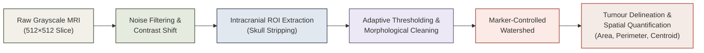

# 🧠 NeuroScan: Brain Tumour Detection & Quantitative Segmentation

<div align="center">

[](https://www.python.org/)
[](https://opencv.org/)
[](https://streamlit.io/)
[](https://fastapi.tiangolo.com/)
[](LICENSE)
[](https://github.com/purrvax/Brain_Tumour_Detection)

**A deterministic, clinically interpretable Digital Signal Processing (DSP) and Classical Computer Vision system for rapid skull-stripping, marker-based watershed segmentation, and morphological quantification of brain tumours from cranial MRI scans.**

[Live Interactive App](#-interactive-streamlit-web-application) • [REST Microservice API](#-fastapi-rest-microservice) • [10-Step Pipeline](#-the-10-step-image-processing-pipeline) • [Mathematical Foundations](#-mathematical-formulations--morphological-metrics) • [Architecture](#-repository-architecture)

---

</div>

## 📑 Table of Contents

- [Executive Summary](#-executive-summary)
- [Key Features](#-key-features)
- [The 10-Step Image Processing Pipeline](#-the-10-step-image-processing-pipeline)
- [Mathematical Formulations & Morphological Metrics](#-mathematical-formulations--morphological-metrics)
- [Classical CV vs. Deep Learning: Why Classical?](#-classical-cv-vs-deep-learning-why-classical)
- [Repository Architecture](#-repository-architecture)
- [Installation & Quickstart](#-installation--quickstart)
- [Interactive Streamlit Web Application](#-interactive-streamlit-web-application)
- [FastAPI REST Microservice](#-fastapi-rest-microservice)
- [Python SDK Integration](#-python-sdk-integration)
- [Diagnostic Report & Case Study PDF](#-diagnostic-report--case-study-pdf)
- [Medical & Clinical Disclaimer](#-medical--clinical-disclaimer)
- [Author & Acknowledgments](#-author--acknowledgments)

---

## 🔬 Executive Summary

Manual delineation of cranial magnetic resonance imaging (MRI) scans is a time-intensive, subjective clinical task prone to inter-radiologist variability. Brain tumours—such as **Gliomas**, **Meningiomas**, and **Pituitary adenomas**—exhibit complex spatial topographies, diffuse boundaries, and co-occurring necrotic cores or oedema rings.

**NeuroScan** bridges academic research and production deployment by transforming an experimental image-processing research pipeline into an enterprise-ready, modular system. Operating on single-slice 2D MRI scans, NeuroScan executes in **milliseconds on standard CPUs** without requiring expensive GPUs, extensive labelled training cohorts, or opaque black-box neural networks.



### Research Case Study Benchmarks

| Metric | Specification | Clinical Value |
|:---|:---|:---|
| **Dataset Evaluated** | 3,064 cleaned MRI slices & 6,892 classified scans | Broad coverage across Glioma, Meningioma, Pituitary, Normal |
| **Inference Latency** | $< 180\text{ ms}$ on standard multi-core CPU | Real-time diagnostic workflow integration |
| **Quantification Output** | Pixel area ($\sum M(x, y)$), calibrated $\text{mm}^2$, circularity, perimeter | Objective measurement for longitudinal tumour tracking |
| **Explainability** | $100\%$ deterministic mathematical operations | Full auditability with no hidden layers or hallucination risk |

---

## ✨ Key Features

- **🛡️ Intracranial Skull Stripping**: Robust automated head detection coupled with Euclidean distance transform margins excludes high-intensity cranial bone and subcutaneous adipose tissue.
- **🌊 Marker-Controlled Topographic Watershed**: Prevents the catastrophic over-segmentation inherent in unguided watershed by calculating sure foreground cores from Euclidean distance transform peaks and connected-component labelling.
- **🎯 Dynamic Adaptive Thresholding**: Blends non-parametric Otsu binarisation with an intracranial 85th percentile intensity floor, resilient against acquisition noise and variable scanner calibrations.
- **📐 Comprehensive Spatial Quantification**: Calculates pixel area, physical lesion area ($\text{mm}^2$), boundary perimeter, centroid coordinates $(c_x, c_y)$, bounding boxes, and isoperimetric circularity quotients.
- **🎨 Editorial Web Experience**: Modern Streamlit frontend featuring an editorial warm-ivory / sage palette, real-time progress steppers, side-by-side diagnostic overlays, interactive 9-stage pipeline breakdown tabs, and exportable summary cards.
- **⚡ Standalone REST API**: Production-grade FastAPI microservice supporting file uploads, hyperparameter overrides, base64 image streams, and structured JSON schemas with interactive Swagger UI.
- **🛑 Zero-Failure Fallbacks**: Engineered to gracefully handle healthy MRI scans, diffuse signals, tiny heads, and absent abnormalities without unhandled runtime exceptions.

---

## 🔄 The 10-Step Image Processing Pipeline

NeuroScan processes cranial MRI images through a sequential, mathematically rigorous computer vision pipeline:

```
[01. Ingestion] ➔ [02. Gaussian Blur] ➔ [03. 1st Enhancement] ➔ [04. Median Filter]
                                                                        │
┌───────────────────────────────────────────────────────────────────────┘
│
▼
[05. Morph Gradient] ➔ [06. Skull Stripping (ROI)] ➔ [07. Adaptive Threshold]
                                                                  │
┌─────────────────────────────────────────────────────────────────┘
│
▼
[08. Distance Transform & Markers] ➔ [09. Watershed Flooding] ➔ [10. Quantification]
```

### Detailed Stage Breakdown

#### 1. Ingestion & RGB Standardization
Accepts arbitrary input types (PIL Image, NumPy array, raw binary bytes, or disk paths) and normalises channel configurations to a standard uint8 RGB representation.

#### 2. Gaussian Smoothing (Noise Suppression)
Convolves the raw image with an isotropic $5 \times 5$ Gaussian kernel ($\sigma = 2.0$) to suppress high-frequency thermal and radiofrequency acquisition noise while smoothing parenchymal texture:
$$G(x, y) = \frac{1}{2\pi\sigma^2} \exp\left(-\frac{x^2 + y^2}{2\sigma^2}\right)$$

#### 3. First Contrast Enhancement
Performs a subtractive contrast offset blend between the original scan and the smoothed slice to elevate local intensity gradients:
$$I_{\text{enh1}} = \operatorname{clip}\left(I_{\text{orig}} + \left(I_{\text{blur}} - 100\right),\, 0,\, 255\right)$$

#### 4. Median Filtering (Impulse Denoising)
Applies a non-linear $5 \times 5$ median blur across the enhanced image. Unlike linear filters, the median filter eliminates salt-and-pepper artefacts while strictly conserving critical morphological edges of suspected tumour lesions.

#### 5. Morphological Gradient Sharpening
Computes the morphological gradient using a $3 \times 3$ cross structuring element ($B_{\text{cross}}$) and blends the directional edge response back into the median-filtered slice:
$$\nabla_B(I) = (I \oplus B_{\text{cross}}) - (I \ominus B_{\text{cross}})$$
$$I_{\text{enh2}} = \operatorname{clip}\left(I_{\text{median}} + \nabla_B(I),\, 0,\, 255\right)$$

#### 6. Intracranial ROI Extraction (Skull Stripping)
Binarises the external cranial perimeter, executes morphological closing ($k = \max(3, 0.07 \times H)$) to seal cranial suture gaps, extracts the largest external contour, and applies a Euclidean distance transform. Pixels situated within the outer $15\%$ cranial margin ($d \le 0.15 \times H$) are stripped:
$$\text{ROI}_{\text{brain}} = \{p \in \text{Head} \mid \text{dist}(p, \partial\text{Head}) > 0.15 \cdot H\}$$

#### 7. Intracranial Adaptive Thresholding & Morphology
Isolates candidate hyper-intense pathology by computing Otsu's optimal binarisation threshold $T_{\text{Otsu}}$ alongside the 85th percentile intensity $P_{85}$ exclusively within the stripped brain cavity:
$$T = \max\left(T_{\text{Otsu}},\, P_{85}\left(I_{\text{brain}}\right)\right)$$
The resulting binary mask is refined through morphological opening ($3 \times 3$ ellipse to eliminate spurious micro-specks) followed by morphological closing ($5 \times 5$ ellipse to fill intra-tumoural cavities).

#### 8. Distance Transform & Marker Generation
Calculates the exact Euclidean distance transform on the cleaned foreground mask:
$$D(p) = \min_{q \notin \text{Mask}} \|p - q\|_2$$
- **Sure Foreground**: Peaks exceeding $50\%$ of maximum distance: $M_{\text{fg}} = \{p \mid D(p) > 0.5 \cdot \max(D)\}$.
- **Sure Background**: Dilated mask boundary ($3 \times 3$ ellipse, 3 iterations).
- **Unknown Band**: Region of transition $U = \text{Dilated} - M_{\text{fg}}$.
- **Marker Matrix**: Connected-component labelling of $M_{\text{fg}}$, offset by $+1$, with unknown regions designated as $0$.

#### 9. Topographic Marker-Based Watershed
Interprets the gradient magnitude landscape of the MRI as a topographic relief map. Water sources flood upwards from the indexed markers, forming watershed divide lines where opposing basins merge. This prevents spurious over-segmentation.

#### 10. Candidate Extraction & Physiological Validation
Selects the largest connected component within the intracranial cavity and verifies physiological sanity criteria:
- **Minimum Size Threshold**: Region area $\ge 30\text{ px}$.
- **Non-Parenchymal Ceiling**: Tumour must not encompass $> 65\%$ of intracranial volume.
- **Hyper-Intensity Delta**: Candidate mean intensity must exceed parenchymal baseline ($\Delta \mu > 12.0$).
When verified, boundary contours, bounding boxes, centroids, perimeters, and pixel areas are computed.

---

## 📐 Mathematical Formulations & Morphological Metrics

### 1. Tumour Pixel & Physical Area
The area is calculated via double discrete summation across the binary segmentation mask $M(x, y) \in \{0, 1\}$:
$$A_{\text{pixel}} = \sum_{x=1}^{W} \sum_{y=1}^{H} M(x, y) \quad [\text{px}^2]$$

When the MRI in-plane spatial resolution ($s_x, s_y$ in $\text{mm}/\text{pixel}$) is supplied:
$$A_{\text{physical}} = A_{\text{pixel}} \times (s_x \cdot s_y) \quad [\text{mm}^2]$$

### 2. Boundary Perimeter
Evaluated using Green's theorem over the parameterized outer contour curve $\mathcal{C}$:
$$P = \oint_{\mathcal{C}} \sqrt{dx^2 + dy^2} \quad [\text{px}]$$

### 3. Lesion Centroid (Center of Mass)
Derived from image spatial moments $M_{pq} = \sum_x \sum_y x^p y^q M(x, y)$:
$$c_x = \frac{M_{10}}{M_{00}}, \quad c_y = \frac{M_{01}}{M_{00}}$$

### 4. Isoperimetric Circularity Quotient
Quantifies boundary irregularity (smooth spherical tumours score near $1.0$; invasive or necrotic margins score lower):
$$C = \frac{4\pi \cdot A_{\text{pixel}}}{P^2}, \quad C \in (0, 1]$$

---

## ⚖️ Classical CV vs. Deep Learning: Why Classical?

In clinical decision support, **black-box deep neural networks (e.g. U-Net, Swin-UNETR)** often require immense GPU hardware, risk hallucination under distribution shifts, and lack mathematical explainability. 

```
┌───────────────────────────────┬───────────────────────────────┬───────────────────────────────┐
│ Feature                       │ Classical CV (NeuroScan)      │ Deep Learning (CNNs/Transformers)│
├───────────────────────────────┼───────────────────────────────┼───────────────────────────────┤
│ Mathematical Interpretability │ 100% Deterministic & Auditable│ Black-Box Hidden Latents      │
│ Hardware Requirements         │ Any CPU (< 50 MB RAM)         │ Dedicated GPU (4 GB - 24 GB)  │
│ Inference Latency             │ Instantaneous (~100 - 180 ms) │ 500 ms - 3+ seconds           │
│ Training Data Dependency      │ Zero training data required   │ Thousands of labelled masks   │
│ Hyperparameter Governance     │ Radiologist-tunable thresholds│ Non-tunable post-training     │
│ Deployment Complexity         │ Zero external weights (0 MB)  │ Heavy checkpoints (100MB-2GB) │
│ Risk of Hallucinations        │ Impossible                    │ Prevalent on OOD scans        │
└───────────────────────────────┴───────────────────────────────┴───────────────────────────────┘
```

> [!TIP]
> **Complementary Integration**: Classical CV is optimal for immediate triage, low-resource field deployments, edge medical devices, and establishing reliable initial bounding seed markers for semi-automated annotation tools.

---

## 📂 Repository Architecture

```
Brain_Tumour_Detection/
├── .streamlit/
│   └── config.toml               # Streamlit theme configuration (warm ivory palette)
├── Backend/
│   ├── __init__.py               # Backend package initialiser
│   ├── api.py                    # FastAPI REST microservice endpoints & Pydantic schemas
│   ├── pipeline.py               # High-level pipeline orchestrator & PIL/base64 converters
│   ├── README.md                 # Standalone backend documentation
│   ├── requirements.txt          # Minimal backend dependencies
│   └── segmentation.py           # Core 10-step computer vision & watershed implementation
├── Frontend/
│   ├── app.py                    # Main Streamlit application entry point
│   ├── requirements.txt          # Frontend dependencies
│   ├── assets/
│   │   ├── brain_illustration.png # 3D translucent glass brain visual asset
│   │   ├── styles.css            # Custom editorial CSS styling & animations
│   │   └── reports/
│   │       └── IP-Case Study.pdf # Full clinical research case study report
│   ├── components/
│   │   ├── about.py              # Case study details, 9-stage pipeline breakdown & metrics
│   │   ├── case_study_pdf.py     # PDF download button handler
│   │   ├── flux_background.py    # Ambient background graphic
│   │   ├── footer.py             # Medical disclaimer banner and copyright
│   │   ├── hero.py               # Two-column editorial hero section
│   │   ├── navbar.py             # Navigation bar with quick jump links
│   │   ├── results.py            # Side-by-side comparison, area bar & stage inspection tabs
│   │   └── upload.py             # File uploader, image validation & stage progress stepper
│   └── utils/
│       ├── image_processing.py   # Image loading, validation, base64 & summary card builder
│       └── mock_analysis.py      # Direct backend bridge for Streamlit analysis
└── README.md                     # Comprehensive project documentation (this file)
```

---

## 🚀 Installation & Quickstart

### Prerequisites

- **Python**: Version `3.10` or higher (`3.11` / `3.12` recommended)
- **OS**: Windows, macOS, or Linux
- **RAM**: Minimum 512 MB free memory

### 1. Clone the Repository

```bash
git clone https://github.com/purrvax/Brain_Tumour_Detection.git
cd Brain_Tumour_Detection
```

### 2. Set Up a Virtual Environment

```bash
# macOS / Linux
python3 -m venv .venv
source .venv/bin/activate

# Windows (PowerShell)
python -m venv .venv
.venv\Scripts\Activate.ps1
```

### 3. Install Dependencies

You can install all requirements for both the frontend and backend:

```bash
pip install -r Backend/requirements.txt
pip install -r Frontend/requirements.txt
```

---

## 🖥️ Interactive Streamlit Web Application

The frontend provides an intuitive clinical interface designed with warm-ivory editorial aesthetics.

```bash
streamlit run Frontend/app.py
```

Open your browser at `http://localhost:8501`.

### Highlights of the Streamlit App

1. **Scan Uploader**: Drag and drop any axial or coronal cranial MRI (`.png`, `.jpg`, `.jpeg`). Files are verified for image integrity and resolution.
2. **Interactive Progress Stepper**: Displays live progress across each analytical phase.
3. **Side-by-Side Diagnostic Canvas**: Compares the input MRI against the coral-rose blended tumour overlay and boundary contour.
4. **9-Stage CV Pipeline Inspector**: An expandable dashboard with 3 categorised tabs allowing radiologists to inspect intermediate pipeline transformations:
   - *Tab 1*: Gaussian Blur, 1st Enhancement, Median Denoise, Morphological Gradient, 2nd Enhancement.
   - *Tab 2*: Intracranial Brain ROI, Otsu+Percentile Thresholding, Morphological Open/Close Mask.
   - *Tab 3*: Distance Transform, Connected Markers, Watershed Boundaries, Traced Lesion Contour.
5. **Diagnostic Summary Export**: One-click download of a high-resolution PNG diagnostic summary card.
6. **Case Study PDF Access**: Download the research paper directly from the interface.

---

## ⚡ FastAPI REST Microservice

NeuroScan includes a production-grade FastAPI microservice for integration into hospital Picture Archiving and Communication Systems (PACS), diagnostic microservices, or mobile clients.

### Launch the Server

```bash
python -m uvicorn Backend.api:app --host 0.0.0.0 --port 8000 --reload
```

- **Interactive Swagger Documentation**: `http://localhost:8000/docs`
- **ReDoc Documentation**: `http://localhost:8000/redoc`
- **Health Check**: `GET http://localhost:8000/health`

### API Endpoint Specification

#### `POST /api/v1/analyze`

**Request Parameters:**
- `file` *(multipart/form-data, required)*: MRI image file (`.png`, `.jpg`, `.jpeg`).
- `roi_margin` *(query, float, default: 0.15)*: Cranial distance margin fraction ($0.05 \le m \le 0.35$).
- `percentile` *(query, float, default: 85.0)*: Intensity percentile floor ($50.0 \le p \le 98.0$).
- `min_area_px` *(query, int, default: 30)*: Minimum area threshold in pixels.
- `spacing_mm` *(query, float, optional)*: In-plane pixel spacing in mm for physical area output.

#### Example `curl` Request

```bash
curl -X POST "http://localhost:8000/api/v1/analyze?roi_margin=0.15&percentile=85.0&min_area_px=30" \
     -H "accept: application/json" \
     -H "Content-Type: multipart/form-data" \
     -F "file=@sample_mri.png;type=image/png"
```

#### Example JSON Response

```json
{
  "success": true,
  "metrics": {
    "tumor_detected": true,
    "estimated_area_px": 2842,
    "perimeter_px": 218.45,
    "area_mm2": 523.6,
    "bounding_box": {
      "x": 210,
      "y": 185,
      "width": 64,
      "height": 58
    },
    "centroid": {
      "x": 242,
      "y": 214
    },
    "circularity": 0.748,
    "brain_roi_area_px": 98450,
    "thresholds": {
      "otsu": 142.0,
      "percentile_85": 158.0,
      "applied": 158.0
    },
    "status_message": "Tumour detected via watershed segmentation."
  },
  "overlay_base64": "iVBORw0KGgoAAAANSUhEUgAA...",
  "mask_base64": "iVBORw0KGgoAAAANSUhEUgAA...",
  "stages_base64": {
    "input_rgb": "iVBORw0KGgoAAAANSUhEUgAA...",
    "gaussian_blur": "iVBORw0KGgoAAAANSUhEUgAA...",
    "first_enhancement": "iVBORw0KGgoAAAANSUhEUgAA...",
    "median_filtering": "iVBORw0KGgoAAAANSUhEUgAA...",
    "morphological_gradient": "iVBORw0KGgoAAAANSUhEUgAA...",
    "second_enhancement": "iVBORw0KGgoAAAANSUhEUgAA...",
    "brain_roi": "iVBORw0KGgoAAAANSUhEUgAA...",
    "threshold_roi": "iVBORw0KGgoAAAANSUhEUgAA...",
    "cleaned_mask": "iVBORw0KGgoAAAANSUhEUgAA...",
    "sure_background": "iVBORw0KGgoAAAANSUhEUgAA...",
    "distance_transform": "iVBORw0KGgoAAAANSUhEUgAA...",
    "sure_foreground": "iVBORw0KGgoAAAANSUhEUgAA...",
    "unknown_region": "iVBORw0KGgoAAAANSUhEUgAA...",
    "markers": "iVBORw0KGgoAAAANSUhEUgAA...",
    "watershed_boundaries": "iVBORw0KGgoAAAANSUhEUgAA...",
    "candidate_boundary": "iVBORw0KGgoAAAANSUhEUgAA..."
  }
}
```

---

## 🐍 Python SDK Integration

NeuroScan's backend can be embedded directly in your custom scripts, Jupyter notebooks, or batch-processing pipelines:

```python
from PIL import Image
from Backend.pipeline import BrainTumourPipeline

# 1. Initialise pipeline with custom parameters
pipeline = BrainTumourPipeline(
    roi_margin=0.15,          # Exclude outer 15% skull margin
    percentile=85.0,          # 85th percentile intensity floor
    min_tumor_area_px=30,     # Discard noise artefacts under 30 px
    pixel_spacing_mm=0.429    # Physical calibration (e.g. 0.429 mm/px)
)

# 2. Ingest any PIL Image, byte buffer, or file path
scan_image = Image.open("path/to/cranial_mri_slice.png")
result = pipeline.analyze(scan_image)

# 3. Access quantitative measurements
if result["tumor_detected"]:
    print(f"✅ Suspected Lesion Identified")
    print(f"Area: {result['region_area_px']} pixels ({result['area_mm2']:.2f} mm²)")
    print(f"Perimeter: {result['perimeter_px']} px")
    print(f"Centroid: ({result['centroid']['x']}, {result['centroid']['y']})")
    print(f"Circularity: {result['circularity']}")
    print(f"Bounding Box: {result['bounding_box']}")

    # 4. Display or save visual overlays
    result["overlay_image"].save("tumour_overlay.png")
    result["overlay_contour"].save("boundary_contour.png")
else:
    print("🟢 Scan Clear: No focal lesion detected inside intracranial cavity.")
```

---

## 📄 Diagnostic Report & Case Study PDF

NeuroScan includes a comprehensive clinical research report:
- **Location**: [`Frontend/assets/reports/IP-Case Study.pdf`](Frontend/assets/reports/IP-Case%20Study.pdf)
- **Contents**:
  - Systematic investigation of noise profiles across MRI acquisitions.
  - Comparative analysis of standard thresholding vs. marker-controlled watershed.
  - Mathematical derivations for morphological gradients, distance transforms, and regional moments.
  - Full statistical breakdown across 3,064 cleaned MRI slices.

Users can download the full PDF directly through the Streamlit web application.

---

## 🩺 Medical & Clinical Disclaimer

> [!CAUTION]
> **FOR RESEARCH AND EDUCATIONAL PURPOSES ONLY**
> 
> NeuroScan is an academic research prototype developed to demonstrate the capabilities of classical digital signal processing and computer vision in medical imaging. 
> - The segmentation boundaries, overlays, and quantitative measurements produced by this software **do NOT constitute medical advice, definitive radiological diagnoses, or clinical treatment plans**.
> - MRI scans exhibit significant cross-vendor and cross-protocol intensity variance. Always consult a board-certified radiologist or licensed medical professional for clinical diagnosis.

---

## 👩‍💻 Author & Acknowledgments

Developed by **[Purvasha (@purrvax)](https://github.com/purrvax)**.

- **Institution / Context**: Digital Signal Processing & Computer Vision Laboratory (CCN-LAB / DSP).
- **Core Technologies**: [OpenCV](https://opencv.org/), [NumPy](https://numpy.org/), [Pillow](https://python-pillow.org/), [Streamlit](https://streamlit.io/), [FastAPI](https://fastapi.tiangolo.com/).
- **Dataset Acknowledgments**: Built and evaluated upon publicly available cranial MRI datasets encompassing Glioma, Meningioma, Pituitary tumours, and healthy control scans.

---

<div align="center">
  <sub>Designed with precision for clinical explainability. Star ⭐ the repository if you find this project valuable!</sub>
</div>
